# waLBerla, pystencils, lbmpy and friends, in diagrams

Diagrams drawn from the papers in this folder. Each section names the paper (path relative to
`docs/papers/`) the content comes from. Two things are **not** in any paper and come from our
submodules instead: pystencils-sfg and SweepGen (`submodules/walberla/doc/setup.md`,
`submodules/walberla/sweepgen/pyproject.toml`). They are marked where they appear.

Short definitions for the abbreviations are in the [glossary](#glossary) at the end.

Contents

1. [The whole stack: who feeds what](#1-the-whole-stack-who-feeds-what)
2. [Timeline of the papers](#2-timeline-of-the-papers)
3. [pystencils abstraction layers](#3-pystencils-abstraction-layers)
4. [What `create_kernel` does](#4-what-create_kernel-does)
5. [lbmpy abstraction layers](#5-lbmpy-abstraction-layers)
6. [lbmpy collision step in moment / cumulant space](#6-lbmpy-collision-step-in-moment--cumulant-space)
7. [How lbmpy cuts the FLOP count](#7-how-lbmpy-cuts-the-flop-count)
8. [Streaming patterns and memory traffic](#8-streaming-patterns-and-memory-traffic)
9. [waLBerla domain setup: from bounding box to time loop](#9-walberla-domain-setup-from-bounding-box-to-time-loop)
10. [waLBerla communication layers](#10-walberla-communication-layers)
11. [Build-time code generation in waLBerla (legacy path)](#11-build-time-code-generation-in-walberla-legacy-path)
12. [What the glue generates](#12-what-the-glue-generates)
13. [Old vs new LBM module in waLBerla](#13-old-vs-new-lbm-module-in-walberla)
14. [A time step with communication hiding](#14-a-time-step-with-communication-hiding)
15. [Kerncraft: CPU performance model](#15-kerncraft-cpu-performance-model)
16. [Warpspeed: GPU performance model inside pystencils](#16-warpspeed-gpu-performance-model-inside-pystencils)
17. [Sparse LBM data structure](#17-sparse-lbm-data-structure)
18. [MESA-PD: generated particle code](#18-mesa-pd-generated-particle-code)
19. [ExaStencils coupled to waLBerla](#19-exastencils-coupled-to-walberla)
20. [waLBerla-wind: an application on top of the stack](#20-walberla-wind-an-application-on-top-of-the-stack)

---

## 1. The whole stack: who feeds what

Solid arrows carry code or symbolic expressions from one tool to the next. Dotted arrows are
optional tools or separate generators.

Sources: `walberla/walberla-a-block-structured.pdf` §6, `lbmpy/holzer-phd-thesis-2024.pdf` Ch. 4,
`pystencils/hennig-cecam2024-pystencils-lbmpy-slides.pdf`; SweepGen / pystencils-sfg from the
waLBerla submodule.

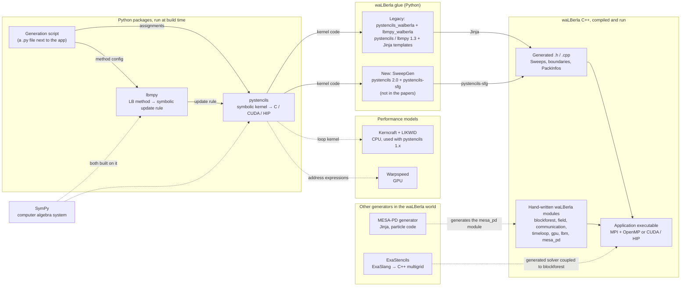

---

## 2. Timeline of the papers

Everything in this folder, plus two context papers that are not downloaded (marked *context*).
The pystencils 2.0 dates are the git tags in our pystencils submodule.

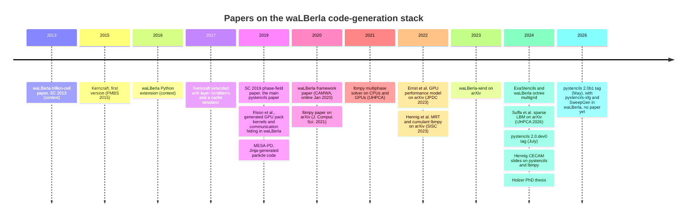

---

## 3. pystencils abstraction layers

Each layer is a SymPy-based representation; you can enter at any layer. The energy-functional
layer is only used for phase-field models (SC'19). The thesis lists the SIMD instruction sets
pystencils 1.x supports: SSE, AVX, AVX512, NEON, SVE, SME, RISC-V V and VSX.

Sources: `pystencils/pystencil.pdf` §3 (Fig. 1), `lbmpy/holzer-phd-thesis-2024.pdf` §4.2.2 (Fig. 4.1).

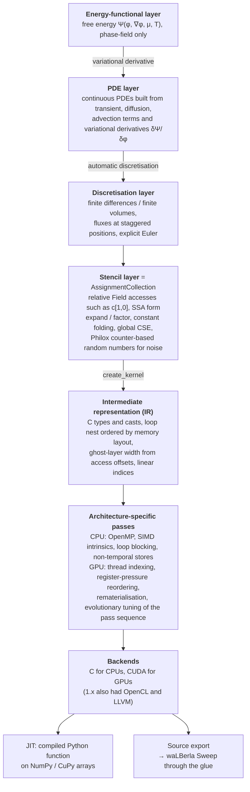

---

## 4. What `create_kernel` does

The step from the stencil layer to the IR, in the order the thesis describes it (pystencils 1.x).
Boundary conditions use the *indexed kernel* variant: one loop over a list of boundary cells
instead of a loop nest over the whole block.

Source: `lbmpy/holzer-phd-thesis-2024.pdf` §4.2.2.

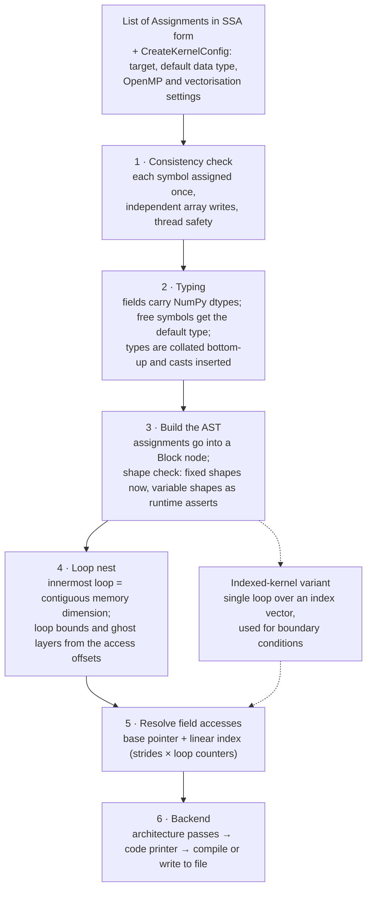

---

## 5. lbmpy abstraction layers

Up to the collision rule, lbmpy only uses SymPy and works on one cell. pystencils `Field`s enter at
the update rule, where the streaming pattern turns symbolic populations into neighbour accesses.

Sources: `lbmpy/holzer-phd-thesis-2024.pdf` §4.3 (Fig. 4.4),
`lbmpy/lbmpy-mrt-cumulant-sisc2023-arxiv2211.02435.pdf` §3–4 (Fig. 3.1),
`lbmpy/lbmpy-jocs2021-arxiv2001.11806.pdf` §II.

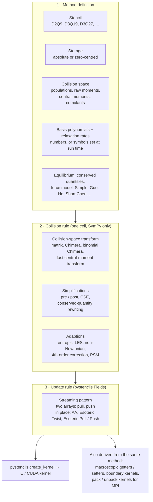

---

## 6. lbmpy collision step in moment / cumulant space

How a cumulant collision is assembled. A raw-moment MRT method stops at raw moments; a
central-moment method stops at central moments. The Chimera transforms sum over z, then y, then x,
so each (population × velocity power) product is computed once. The back transform is split into
symmetric and antisymmetric parts, which roughly halves its operations.

Sources: `lbmpy/lbmpy-mrt-cumulant-sisc2023-arxiv2211.02435.pdf` §4.1–4.2,
`lbmpy/holzer-phd-thesis-2024.pdf` §4.3.3.

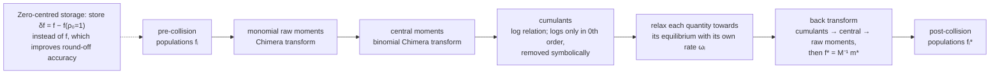

---

## 7. How lbmpy cuts the FLOP count

D3Q19 BGK (single relaxation time), compressible, counts from Table I of the lbmpy paper.
Generic SymPy CSE alone reaches 261; lbmpy's own sequence reaches 193, below the best
hand-optimised kernel (204).

Source: `lbmpy/lbmpy-jocs2021-arxiv2001.11806.pdf` §IV-A, Table I.

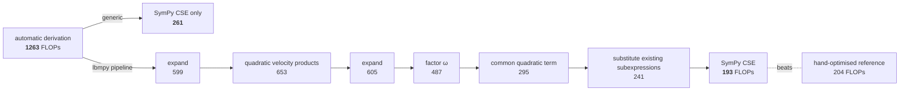

---

## 8. Streaming patterns and memory traffic

Q is the number of populations per cell (19 for D3Q19). With normal stores a CPU first reads the
cache line it is about to overwrite ("write-allocate"), so a two-array kernel moves 3Q values per
cell; non-temporal stores skip that read and bring it to 2Q. In-place patterns write back to lines
they just read, so they move 2Q with half the memory. Working out which values an in-place pattern
must send to a neighbour process by hand is error-prone, which is why lbmpy generates the pack
kernels too.

Sources: `lbmpy/lbmpy-jocs2021-arxiv2001.11806.pdf` §IV-B/C (Figs. 2–4),
`lbmpy/lbmpy-mrt-cumulant-sisc2023-arxiv2211.02435.pdf` §4.4.

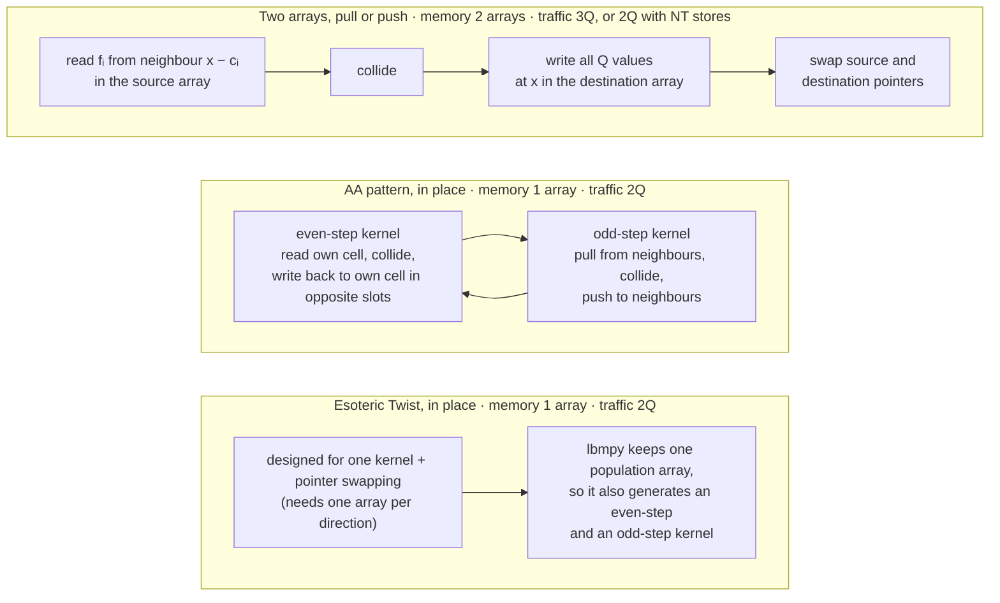

---

## 9. waLBerla domain setup: from bounding box to time loop

The setup phase uses lightweight blocks (no simulation data) so refinement and load balancing stay
cheap. Only after the blocks are distributed do processes allocate the heavy data.

Sources: `walberla/walberla-a-block-structured.pdf` §3, `lbmpy/holzer-phd-thesis-2024.pdf` §4.4.2–4.4.3.

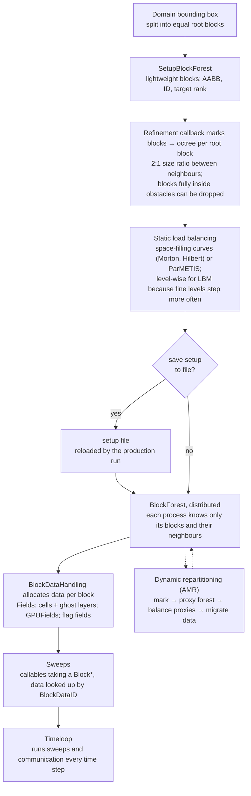

---

## 10. waLBerla communication layers

Bottom to top: only the top layer knows about blocks. A *PackInfo* says **what** to exchange for one
block and one neighbour direction; a *communication scheme* says **how** (all at once, or
start/wait to overlap with computation).

Sources: `walberla/walberla-a-block-structured.pdf` §3.3 (Fig. 3), `lbmpy/holzer-phd-thesis-2024.pdf` §4.4.4,
`walberla/Scalable_GPU_Communication_with_Code_Generation_on_Stencil_Applications.pdf` §IV,
`pystencils/pystencil.pdf` §4.3.

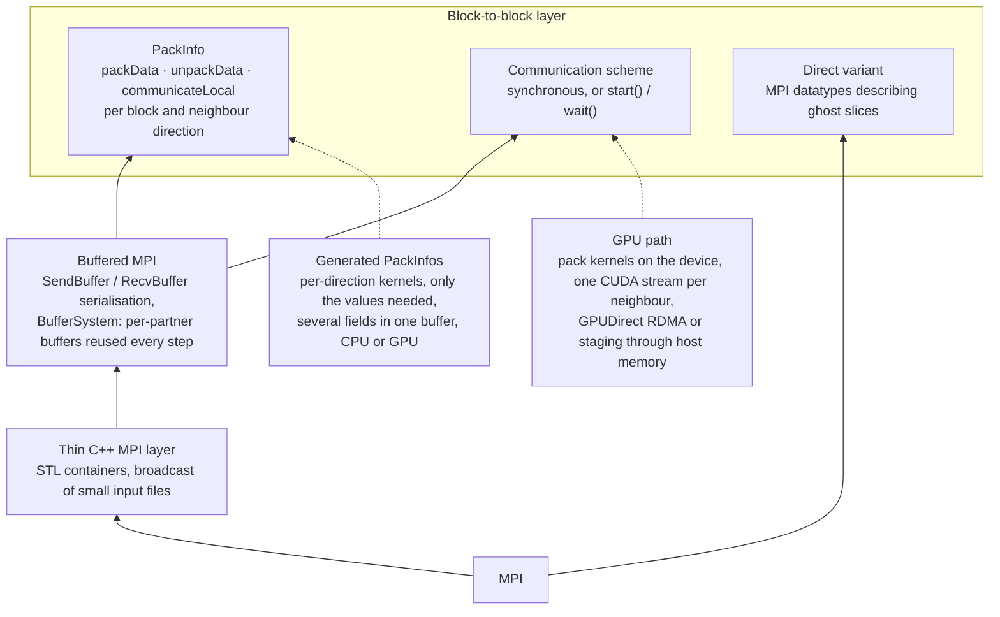

---

## 11. Build-time code generation in waLBerla (legacy path)

What happens when you build an app that uses `pystencils_walberla` / `lbmpy_walberla`. Nothing
extra runs on the compute nodes: the generated files are ordinary C++ by then. (The SC'19 paper also
describes an interactive mode where kernels are compiled into Python extension modules and waLBerla
is driven from Python.)

Sources: `lbmpy/holzer-phd-thesis-2024.pdf` §4.4.5 (Fig. 4.7, Listing 4.7), `pystencils/pystencil.pdf` §4.2.
Function names checked against `submodules/walberla/python/`.

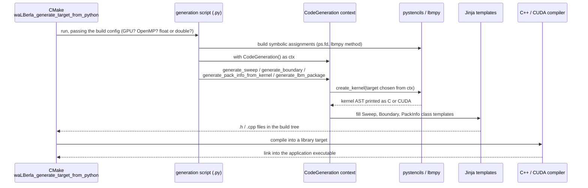

---

## 12. What the glue generates

One generation script produces several C++ classes. The same symbolic description drives all of
them, so kernels, boundaries and communication always agree on which values are read.

Sources: `lbmpy/holzer-phd-thesis-2024.pdf` §4.4.5–4.4.6, `lbmpy/lbmpy-jocs2021-arxiv2001.11806.pdf` §IV-D,
`lbmpy/lbmpy-multiphase-ijhpca2021-arxiv2012.06144.pdf` (Fig. 2).

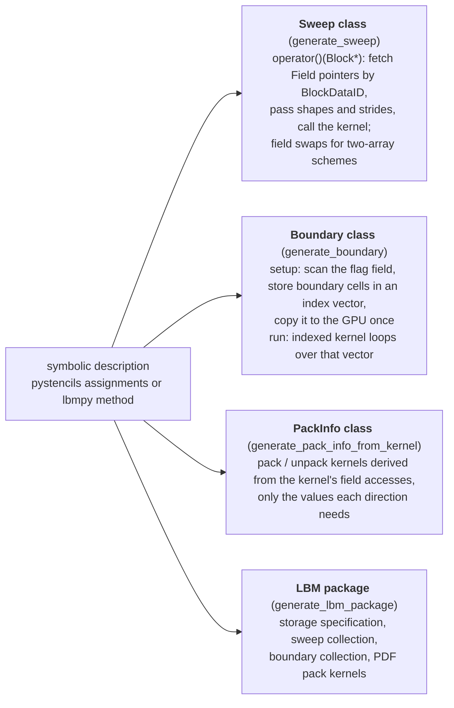

---

## 13. Old vs new LBM module in waLBerla

The old `lbm` module is hand-written C++ templates (static polymorphism): the lattice model is a
template parameter of the PDF field, only pull streaming is supported, and GPUs are not. The new
module (from the Holzer thesis) generates a *storage specification* that describes the method,
including its streaming pattern and pack kernels, and keeps the algorithms in a separate sweep
collection, so a GPU field can use the same description.

Source: `lbmpy/holzer-phd-thesis-2024.pdf` §4.4.6 (Figs. 4.8, 4.9).

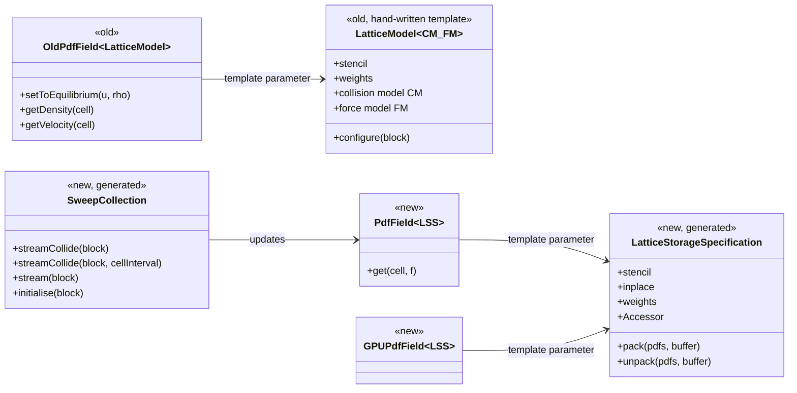

---

## 14. A time step with communication hiding

Left: communicate, then compute everything. Right: compute the outer frame (cells next to the ghost
layers) first, send it while the inner region is computed on a separate stream, and synchronise at
the end. The multiphase paper uses the same frame / interior split; on a V100 a frame width of
(32, 8, 8) cells worked best.

Sources: `walberla/Scalable_GPU_Communication_with_Code_Generation_on_Stencil_Applications.pdf` (Fig. 2),
`lbmpy/lbmpy-multiphase-ijhpca2021-arxiv2012.06144.pdf` (Fig. 3), `pystencils/pystencil.pdf` §4.3.

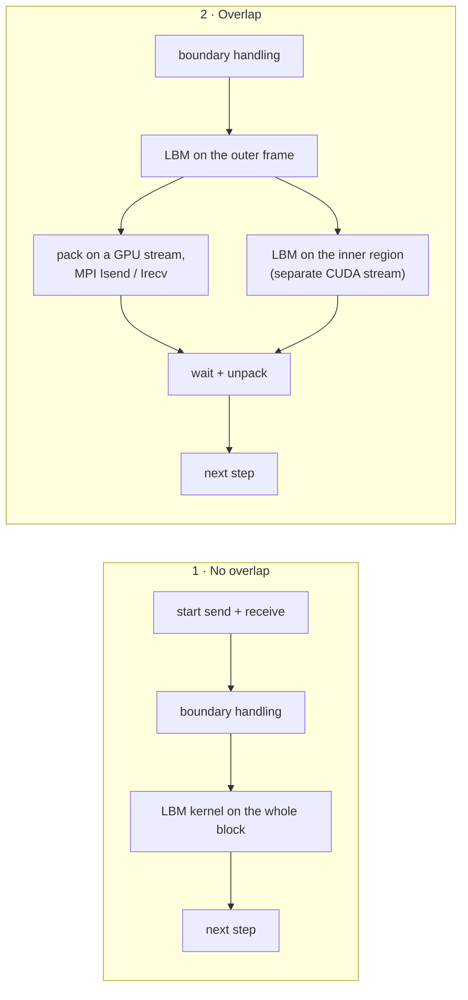

---

## 15. Kerncraft: CPU performance model

Kerncraft predicts how fast a loop kernel runs from its source and a description of the machine.
In SC'19 the pystencils IR was handed to Kerncraft to pick between kernel variants (for example
split vs fused kernels) and blocking sizes. The pystencils 2.0b1 in our submodule no longer
contains this coupling.

Sources: `kerncraft/kerncraft-2017-arxiv1702.04653.pdf` §2 (Fig. 2), `pystencils/pystencil.pdf` §3.6.

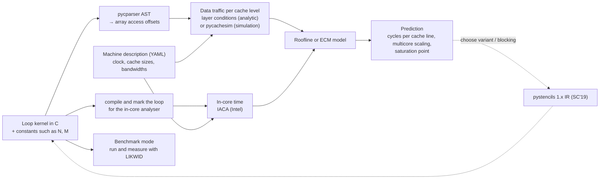

---

## 16. Warpspeed: GPU performance model inside pystencils

Ranks GPU code-generation options (mainly thread-block size) without running them. It needs grid
sizes at generation time and cannot handle indirect addressing.

Sources: `pystencils/pystencils-gpu-perfmodel-jpdc2023-arxiv2204.14242.pdf` §1–4 (Fig. 1),
`lbmpy/holzer-phd-thesis-2024.pdf` (Fig. 4.3).

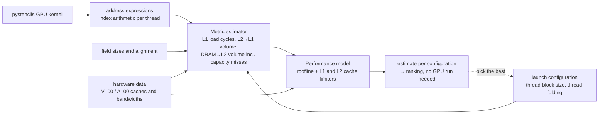

---

## 17. Sparse LBM data structure

For porous media most cells are solid. The sparse layout stores only fluid cells and replaces
neighbour index arithmetic with a list of where each population pulls from. On an A100 with
D3Q19 SRT, sparse beats dense below about 80 % fluid (porosity 0.8), for both speed and memory;
a hybrid setup picks per block.

Source: `lbmpy/lbmpy-sparse-ijhpca2026-arxiv2408.06880.pdf` (Figs. 1, 2, 4).

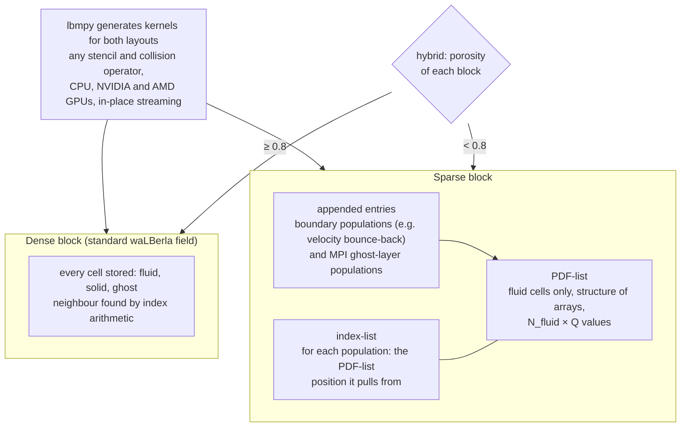

---

## 18. MESA-PD: generated particle code

waLBerla's particle module. It uses the same Jinja mechanism as the pystencils glue, but generates
data structures and their support code rather than stencil kernels. Kernels read and write particle
data only through an *accessor*, so the data layout can change without touching them.

Sources: `walberla/mesapd-dem8-arxiv1906.10963.pdf` §3–6 (Fig. 1), `walberla/walberla-a-block-structured.pdf` §6.2.

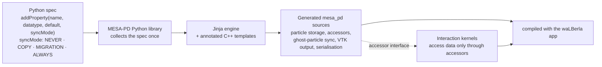

---

## 19. ExaStencils coupled to waLBerla

A different code generator: ExaStencils compiles its own external language (ExaSlang) to whole C++
multigrid programs. This work lets the generated solver run on waLBerla's refined block
structure, with generated communication that interpolates between refinement levels
(quadratic coarse-to-fine, linear fine-to-coarse). pystencils is only mentioned as background.

Source: `exastencils/exastencils-walberla-octree-multigrid-arxiv2403.08063.pdf` §1–3.

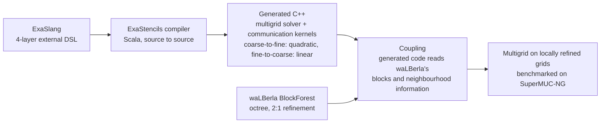

---

## 20. waLBerla-wind: an application on top of the stack

The LBM part is generated with lbmpy (Guo forcing); wind turbines are actuator lines, i.e. forces
on blade elements instead of a resolved blade geometry. Forces are spread with the discrete delta
kernel of Roma et al., whose weights sum to 1, so total force is conserved.

Source: `walberla/walberla-wind-preprint.pdf` (Fig. 1 and the actuator-line section).

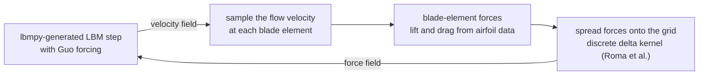

---

## Glossary

| Term | Meaning |
|---|---|
| AABB | axis-aligned bounding box |
| AA pattern, Esoteric Twist | in-place LBM streaming schemes that keep one population array instead of two |
| AMR | adaptive mesh refinement: refining / coarsening blocks while the simulation runs |
| AST / IR | abstract syntax tree / intermediate representation: the tree pystencils transforms before printing code |
| BlockForest | waLBerla's distributed set of blocks (one octree per root block) |
| Chimera transform | moment transform that sums over one velocity axis at a time; intermediates are half populations, half moments |
| CSE | common subexpression elimination: compute repeated terms once |
| DdQq | lattice with d dimensions and q populations per cell (e.g. D3Q19) |
| ECM | execution-cache-memory model: predicts loop runtime from in-core time plus per-cache-level transfer times |
| FLOP | floating-point operation |
| ghost layer | extra cells around a block that hold copies of neighbour data |
| Jinja | Python template engine used to wrap generated kernels in C++ classes |
| JIT | just-in-time compilation: compile the generated code while the Python program runs |
| layer condition | rule for whether stencil rows / planes stay in a cache, used to predict memory traffic |
| LBM, PDF | lattice Boltzmann method; particle distribution function (one "population" value) |
| MRT / SRT (BGK) / TRT | multiple / single / two relaxation-time collision operators |
| NT store | non-temporal (streaming) store: writes past the cache, avoiding the write-allocate read |
| PackInfo | waLBerla interface that packs / unpacks one block's data for one neighbour direction |
| porosity | fraction of fluid cells in the domain |
| roofline | model bounding performance by peak compute and memory bandwidth |
| SIMD | single instruction, multiple data: vector instructions (AVX, NEON, SVE, RISC-V V, …) |
| SSA | static single assignment: each symbol is assigned exactly once |
| Sweep | waLBerla callable that runs an algorithm on one block |
| UBB | velocity bounce-back boundary condition |
| zero-centred storage | storing the deviation of each population from its rest-state value instead of the value itself |
